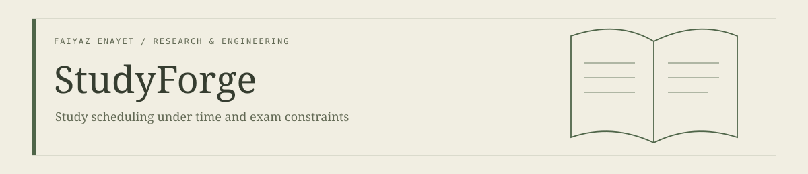
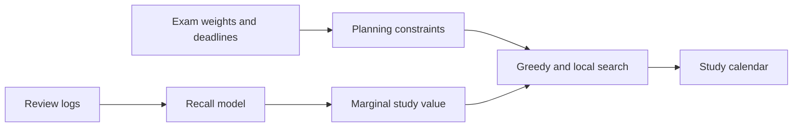

<p align="center"></p>

[](https://github.com/FaiyazEnayet/studyforge/actions/workflows/ci.yml) [](LICENSE)   [](https://faiyazenayet.github.io/studyforge/docs/dashboard.html)

<p align="center"><a href="https://faiyazenayet.github.io/studyforge/docs/dashboard.html"><b>Open interactive demo</b></a> · <a href="docs/dashboard.html">HTML file</a> · <a href="#method">Method</a> · <a href="#run-locally">Run locally</a> · <a href="#limitations">Limitations</a></p>

# StudyForge

StudyForge allocates limited study time across exams. Its schedule makes assumptions about forgetting, topic importance and available time explicit, so a student can inspect the plan rather than accept an unexplained priority list.

**Python · constrained planning · recall estimation**

[](https://faiyazenayet.github.io/studyforge/docs/dashboard.html)


## Explore

- Inspect the actual calendar and the sessions assigned to each day.
- Compare predicted exam readiness and topic forgetting curves.
- Evaluate an extra-hour scenario using the same planning engine.

## Method

A transparent forgetting curve estimates recall at each exam. Greedy allocation and local search choose fixed-length sessions under daily limits, rest days, deadlines and spacing constraints. Logged recall can personalize stability estimates.

## Evidence at a glance

| Scope | Recorded result or contract |
| :--- | :--- |
| Example plan | Three exams and 15 topics over 21 days |
| Scheduled work | 72 sessions; 1,800 study minutes |
| Planning constraints | 120-minute daily cap; 25-minute sessions; three rest days |
| Readiness | Model estimates, not observed future exam scores |

## Run locally


```sh
python -m pip install -e ".[dashboard,dev]"
python -m pip install -r portfolio_ui/requirements.txt
python -m pytest tests -q
python -m studyforge plan --exams exams.yaml
python tools/make_dashboard.py
```

## Technical design

StudyForge models recall with an exponential forgetting curve and increases stability when a review occurs. Fixed-length sessions are allocated using greedy marginal gain followed by local improvement. Daily capacity, rest days, exam deadlines and a spacing guardrail constrain the plan.



## Evaluation protocol

The objective is weighted predicted recall at the exam, not a predicted course grade. Logged recall can personalize stability, but until enough observations exist the parameters are defaults. What-if analysis reruns the same planner with changed time capacity rather than adding a fabricated readiness gain.


The example calendar is a real engine output for its supplied weights and constraints. Its quality depends on those inputs. For conceptual or proof-based exams, understanding-oriented tasks need to be represented separately rather than assuming recall alone measures readiness.

## Code and data

`memory.py` defines forgetting and review updates. `planner.py` handles allocation. `state.py` manages exam configuration and history. `tools/make_dashboard.py` presents actual planner output.


## Limitations

- Initial curve parameters are defaults until enough personal recall data is logged.
- Recall optimization is not a model of conceptual understanding.
- Topic names currently collide across exams and need stable exam/topic identifiers.

## License

[MIT](LICENSE). Third-party datasets, libraries and fonts retain their own terms.
