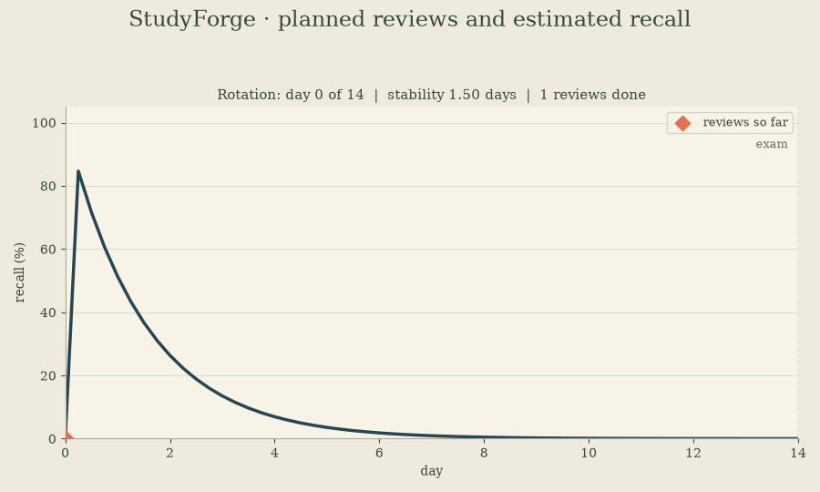
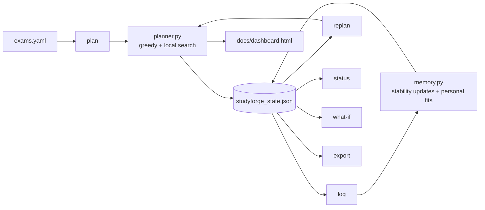

# studyforge


[](https://faiyazenayet.github.io/studyforge/docs/dashboard.html)

**Exam study scheduling under a forgetting curve.** You list your exams, their topics, and how much each topic matters. studyforge builds a day by day plan that maximizes what you will actually remember on exam day.



*Above: Rotation, one of the hardest topics in the example set, animated day by day. Each planned review lands, stability grows, and the curve flattens. Generated from the real engine with `python3 tools/make_demo_gif.py`.*

**Live interactive demo:** open [docs/dashboard.html](https://faiyazenayet.github.io/studyforge/docs/dashboard.html) in a browser. It explores the real planner output for the example exams: the full schedule, per topic forgetting curves, readiness, a what-if comparison, and the personal fitting demo. Everything on the page was computed by the engine, not mocked. Regenerate it any time with `python3 tools/make_dashboard.py`.

I kept making study plans by gut feel. Front load everything, cram the night before, forget half of it by the exam. Spaced repetition research has known the fix for a century. Review a topic right as you are about to forget it. So I built the planner I wanted. It models memory with a forgetting curve, then optimizes the schedule the way you would optimize anything else. Define the objective, respect the constraints, let the algorithm do the rest.

## Quickstart

```bash
pip install -e .
python -m studyforge plan --exams exams.yaml
python -m studyforge status
python -m studyforge log --topic "Rotation" --minutes 25
python -m studyforge replan
python -m studyforge what-if --day 3 --extra-minutes 60
python -m studyforge export --format md --out plan.md
```

State lives in `studyforge_state.json` in the working directory. Override with `--state`.

## How the pieces fit



`memory.py` owns the forgetting curve and the stability update rule. `planner.py` owns the optimizer. `state.py` owns the exams config and the JSON state file. `cli.py` wires the six commands. `dashboard.py` is a thin view layer over all of them. It feeds the HTML dashboard and the GIF script in `tools/`.

## The math

Each topic has a stability S measured in days. Recall t days after a review is:

    R(t) = exp(-t / S)

Harder topics start with lower stability. A difficulty rating from 1 to 5 maps to S0 = 3.0 / difficulty. An easy topic starts at 3.0 days. A hard one starts at 0.6 days.

Reviews grow stability. The update rule is fully transparent, SM-2 style, no black box:

    S' = S * (1 + (1 - R))

R is retrievability at the moment of review. Review at full recall and stability does not move. Review after forgetting everything and stability doubles. The first ever review of a topic counts as full learning. Same day repeats gain nothing. That stops the planner from cramming one topic.

The planner maximizes the sum over topics of (exam weight * predicted recall at exam time). Constraints: a daily minutes cap, rest days with zero sessions, no sessions on or after a topic's exam day, at most two sessions of one topic per day. The algorithm is greedy by marginal gain per minute, then a local search pass that moves or drops sessions until nothing improves. Deterministic. Same inputs give the same plan.


## Your own forgetting rates

The defaults above are a starting guess. When you log a session, add --recall with the fraction you actually remembered when you sat down. 0.7 means seventy percent. Each logged review with a recall score becomes one data point: the days since your last review of that topic, and what you remembered. Once a topic has three such data points, I fit its stability to your history with least squares on log recall, clamped to sane bounds. That fitted value replaces the default in plan and replan from then on. Every new logged review refits it. When you report a recall score, the stability update uses your number instead of the model's prediction. Topics without enough data keep the defaults. Status tells you which is which.

Real output. Four reviews of Rotation were logged with recall scores. The fourth one triggers the fit:

```
$ python -m studyforge log --topic "Rotation" --minutes 25 --day 9 --recall 0.14
Logged 25 min on Rotation (day 9).
Retrievability at review: 14%. Stability: 2.57 -> 4.78 days.
Fitted your personal stability from 3 recall data points: 1.95 days.

$ python -m studyforge status --today 9
...
Rotation                         Physics I Midterm         1.95    100%       5      8%   fitted
...
Stability: 1/15 topics fitted from your logs. The rest use defaults. Log sessions with --recall to personalize more topics.
```


## Demo transcript

Real output from the included `exams.yaml`: three exams, 15 topics, 21 days, 120 minutes per day, three rest days.

```
$ python -m studyforge plan --exams exams.yaml
Study plan: 72 sessions, objective 2.278
Budget: 120 min/day, sessions of 25 min
Day 0 (2026-10-11):
  Psychology Midterm / Brain anatomy: 25 min
  Psychology Midterm / Classical conditioning: 25 min
  Psychology Midterm / Memory models: 25 min
  Physics I Midterm / Rotation: 25 min
Day 1 (2026-10-12):
  Psychology Midterm / Memory models: 25 min
  Physics I Midterm / Momentum: 25 min
  Physics I Midterm / Newton's laws: 25 min
  Psychology Midterm / Sleep and dreams: 25 min
Day 2 (2026-10-13):
  Psychology Midterm / Brain anatomy: 25 min
  Psychology Midterm / Classical conditioning: 25 min
  Psychology Midterm / Research methods: 25 min
  Physics I Midterm / Work and energy: 25 min
...
Day 6 (2026-10-17): rest
...
Day 20 (2026-10-31): rest
```

Psychology topics cluster before the day 7 exam. Calculus topics ramp up toward day 21. Rest days stay empty.

Log what you actually study. Each log updates that topic's stability through the review rule:

```
$ python -m studyforge log --topic "Rotation" --minutes 25 --day 0
Logged 25 min on Rotation (day 0).
Retrievability at review: 0%. Stability: 0.75 -> 1.50 days.
```

`status` shows per topic recall and a per exam readiness score. Readiness is weight normalized predicted recall at exam time with no further study. After logging four sessions on the first two days:

```
$ python -m studyforge status --today 2
...
Per-exam readiness (weighted recall at exam time, no more study):
  Psychology Midterm: 3% (5 topics, 5 days left)
  Physics I Midterm: 0% (5 topics, 12 days left)
  Calculus III Final: 0% (5 topics, 19 days left)
```

Then replan from today. Logged sessions count as past reviews, so the optimizer redistributes the remaining work:

```
$ python -m studyforge replan --today 2
Replanned from day 2: 64 sessions, objective 2.233
Added sessions:
  Day 2: Physics I Midterm / Momentum: 25 min
  Day 3: Psychology Midterm / Memory models: 25 min
  ...
Removed sessions:
  Day 2: Psychology Midterm / Brain anatomy: 25 min
  Day 3: Calculus III Final / Series convergence: 25 min
  ...
```

`what-if` prices extra time. An extra hour on day 3 buys 0.022 on a 2.233 baseline. Small but real, and the tool shows exactly which sessions the extra hour adds and which it displaces:

```
$ python -m studyforge what-if --day 3 --extra-minutes 60 --today 2
Baseline objective: 2.233
With +60 min on day 3: 2.255 (+0.022)
Sessions added by the extra time:
  Day 2: Psychology Midterm / Sleep and dreams: 25 min
  Day 3: Psychology Midterm / Brain anatomy: 25 min
  Day 3: Psychology Midterm / Classical conditioning: 25 min
  Day 3: Calculus III Final / Partial derivatives: 25 min
  ...
Sessions displaced:
  Day 2: Psychology Midterm / Classical conditioning: 25 min
  ...
```

`export` writes the plan to CSV or Markdown for printing or sharing:

```
$ python -m studyforge export --format md --out plan.md
Exported 72 sessions to plan.md
```


## Config reference

```yaml
daily_budget_minutes: 120
session_minutes: 25
rest_days: [6, 13, 20]   # day offsets with no sessions
exams:
  - name: "Physics I Midterm"
    day: 14              # days from today
    topics:
      - { name: "Rotation", difficulty: 4, weight: 0.20 }
```

Difficulty runs 1 (easy) to 5 (hard). Weight is the topic's share of the exam.


## Honest limitations

The curve parameters start as population averages, not yours. Ebbinghaus ran his experiments on himself with nonsense syllables in the 1880s. The shape of forgetting is real. The exact numbers for your brain on organic chemistry are not in this repo, at least not until you log them. Log reviews with --recall and each topic gets its own fitted forgetting rate once you have enough data. Until then the defaults stand in, and status marks which topics are which. Treat the schedule as principled guidance, not a guarantee.

It optimizes recall, not understanding. A topic you can recite is not a topic you can use on a novel problem. For proof based exams, weight understanding work outside the tool.

Garbage topic weights in, garbage plan out. The optimizer trusts your weights completely. If you guess them badly, it will confidently optimize the wrong thing. Spend ten minutes getting weights right before you trust the plan.
